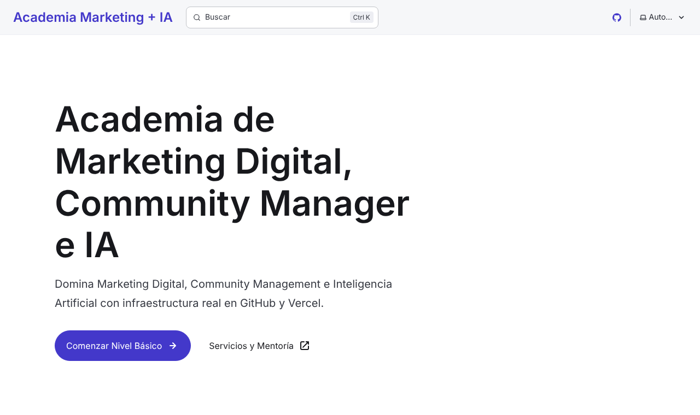
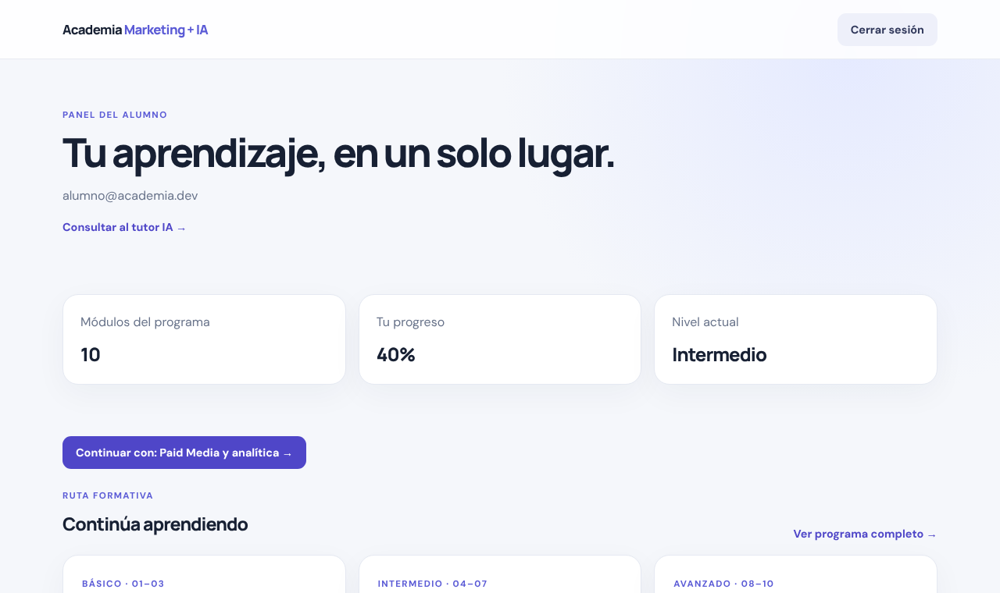
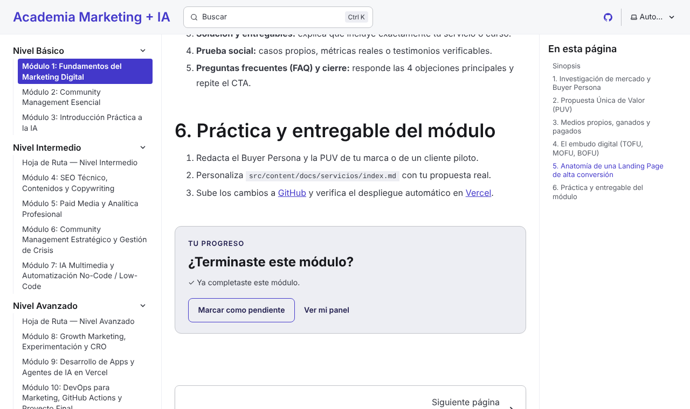
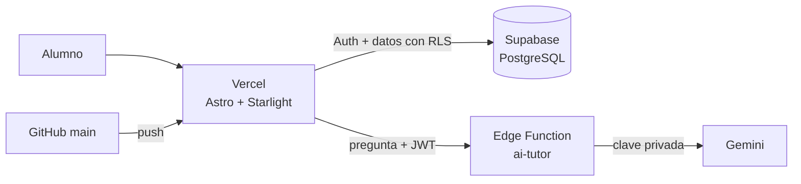

<div align="center">

# Academia Marketing + IA

**Aprende Marketing Digital, Community Management e Inteligencia Artificial con proyectos reales en GitHub y Vercel.**

10 módulos en 3 niveles · portal del alumno con progreso · tutor IA

### 🌐 [academia-marketing-ia.vercel.app](https://academia-marketing-ia.vercel.app)

[](https://academia-marketing-ia.vercel.app)
[](https://github.com/Tradester101/academia-marketing-ia/actions/workflows/ci.yml)




</div>

---

## Accesos rápidos

| | Página | Para qué sirve |
|---|---|---|
| 🏠 | [Programa](https://academia-marketing-ia.vercel.app/) | Página pública con la ruta completa |
| 📘 | [Módulo 1](https://academia-marketing-ia.vercel.app/basico/modulo-01-fundamentos/) | Empieza el nivel básico |
| 🔑 | [Acceso](https://academia-marketing-ia.vercel.app/login) | Registro e inicio de sesión |
| 📊 | [Mi panel](https://academia-marketing-ia.vercel.app/dashboard) | Progreso, nivel y siguiente módulo |
| 🤖 | [Tutor IA](https://academia-marketing-ia.vercel.app/tutor) | Preguntas al tutor con Gemini |
| 🛠️ | [Administración](https://academia-marketing-ia.vercel.app/admin) | Cursos y lecciones (solo rol `admin`) |

## El programa

| Nivel | Módulos | Contenido |
|---|---|---|
| **Básico** | 01–03 | Fundamentos de marketing digital, community management y prompt engineering |
| **Intermedio** | 04–07 | SEO y copywriting, paid media y analítica (GA4, GTM, Data Studio), CM estratégico, IA multimedia y automatización |
| **Avanzado** | 08–10 | Growth marketing y CRO, apps y agentes de IA en Vercel, DevOps con GitHub Actions |

Además: plantillas (brief de cliente, checklist de lanzamiento, librería de prompts) y una página de servicios y mentoría.

## El portal del alumno

<table>
  <tr>
    <td width="50%"></td>
    <td width="50%"></td>
  </tr>
  <tr>
    <td><b>Panel:</b> módulos publicados, porcentaje, nivel actual y botón al siguiente módulo pendiente.</td>
    <td><b>En cada módulo:</b> marcar como completado o pendiente; si no hay sesión, invita a entrar y vuelve al mismo módulo.</td>
  </tr>
</table>

<sub>Capturas generadas con datos de ejemplo.</sub>

## Arquitectura



- **Sitio y portal:** Astro 5 + Starlight, desplegado en Vercel en cada push a `main`.
- **Identidad y datos:** Supabase Auth + PostgreSQL con Row Level Security.
- **Tutor IA:** Supabase Edge Function que llama a Gemini desde el servidor; la clave nunca llega al navegador.
- **CI:** GitHub Actions ejecuta `npm run build` en cada push y pull request.

## Desarrollo local

```sh
git clone https://github.com/Tradester101/academia-marketing-ia.git
cd academia-marketing-ia
cp .env.example .env   # completa las variables PUBLIC_SUPABASE_*
npm install
npm run dev            # http://localhost:4321
```

Sin variables de Supabase el sitio público funciona igual; el portal muestra un aviso de configuración.

## Puesta en marcha de Supabase y Vercel

1. Configura estas variables en Vercel y en tu `.env` local:
   - `PUBLIC_SUPABASE_URL`
   - `PUBLIC_SUPABASE_ANON_KEY` (o la publishable key compatible)
2. No uses claves `service_role` ni claves privadas con prefijo `PUBLIC_`.
3. Aplica `supabase/migrations/0001_lms.sql` en el SQL Editor de Supabase. Crea las tablas, las políticas RLS y carga los 10 módulos.
4. Crea una cuenta desde `/login`.
5. Promueve la cuenta propietaria a administradora en el SQL Editor:
   ```sql
   update public.profiles set role = 'admin' where email = 'OWNER_EMAIL';
   ```
6. Despliega el tutor y configura la clave de Gemini:
   ```sh
   supabase functions deploy ai-tutor
   supabase secrets set GEMINI_API_KEY=TU_CLAVE
   ```
   Supabase Functions ya proporciona `SUPABASE_URL` y `SUPABASE_ANON_KEY`.
7. En Supabase, añade `https://academia-marketing-ia.vercel.app` a las URLs permitidas y como URL de redirección de autenticación.

## Modelo de datos

| Tabla | Contenido | Acceso (RLS) |
|---|---|---|
| `profiles` | Usuario y rol (`student` / `admin`) | Cada usuario ve el suyo; admin ve todos |
| `courses` | Niveles del programa | Público si está publicado; admin gestiona |
| `lessons` | Módulos con su ruta de contenido | Público si está publicado; admin gestiona |
| `enrollments` | Matrículas | Cada alumno las suyas; admin gestiona |
| `lesson_progress` | Módulos completados | Cada alumno el suyo; admin lee todo |

## Estructura

```
src/
├── content/docs/        # Módulos, plantillas y servicios (Markdown)
├── components/          # LessonFooter: progreso al final de cada módulo
├── pages/               # login, dashboard, tutor, admin
└── lib/supabase.ts      # Cliente de Supabase en el navegador
supabase/
├── migrations/          # Esquema, RLS y catálogo inicial
└── functions/ai-tutor/  # Edge Function del tutor IA
public/academy.css       # Estilos del portal
```

## Estado y siguientes pasos

**Incluido hoy**

- Autenticación, panel del alumno, tutor IA y esquema de datos con RLS.
- Administración: crear cursos y lecciones, publicarlos, despublicarlos y eliminarlos.
- Progreso por módulo desde cada página (`src/components/LessonFooter.astro`, que reemplaza el `Footer` de Starlight y localiza la lección por `content_url` o, si no coincide, por `slug`).
- Panel con número de módulos, porcentaje y nivel calculados a partir de las lecciones publicadas.

**Pendiente**

- Editar cursos y lecciones existentes desde `/admin`.
- Usar la tabla `enrollments` para matricular alumnos en cursos concretos.
- Límite de uso del tutor IA por alumno.

---

<div align="center">
<sub>Hecho con Astro, Supabase y Vercel · <a href="https://academia-marketing-ia.vercel.app">academia-marketing-ia.vercel.app</a></sub>
</div>
